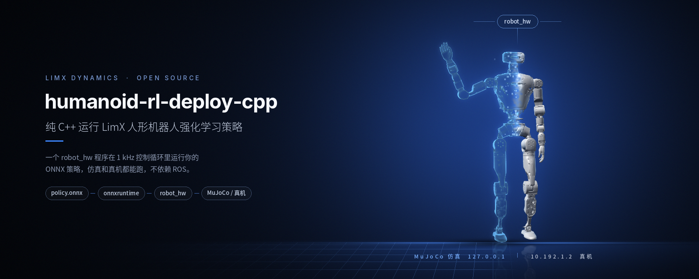
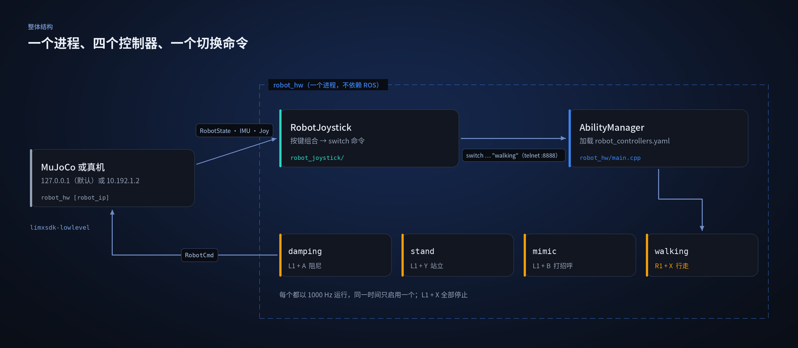
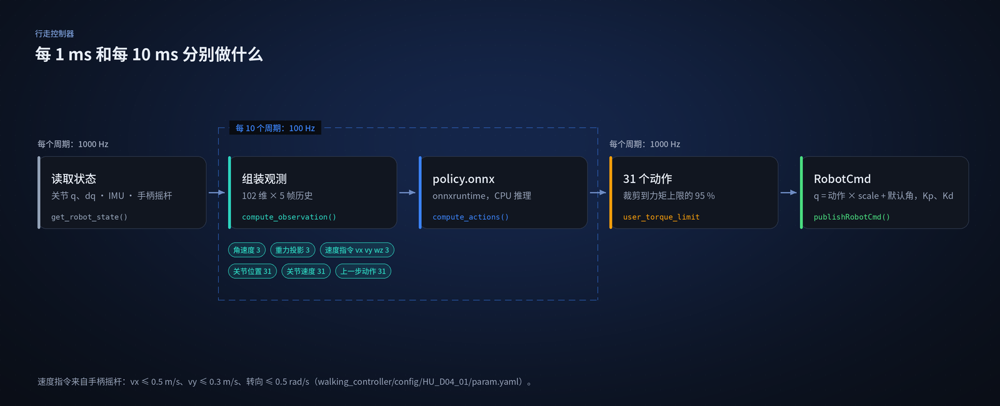

<p align="center">
  
</p>

<p align="center">
  <a href="README.md">English</a> | <b>中文</b>
</p>

<p align="center">
  <a href="LICENSE"></a>
  
  
  
</p>

# 训练结果部署

## 1、概述

若无需依赖 ROS 系统，仅用 C++ 开发，可参考本部署示例。示例涵盖环境配置、编译流程及基础功能实现。代码结构清晰，便于复用或扩展，能降低开发门槛，助力高效完成项目搭建与迭代。

<p align="center">
  
</p>

`robot_hw` 会把 `robot_hw/robot_controllers.yaml` 里列出的控制器都加载到一个进程中。每个控制器都以 1000 Hz 运行，但同一时间只启用一个，由手柄切换。

## 2、工程环境搭建

推荐以操作系统 Ubuntu 20.04 及以上版本为例，按照下面方法安装工程依赖。

### 2.1 编译环境

```bash
sudo apt update
sudo apt install cmake build-essential libeigen3-dev libyaml-cpp-dev python3 python3-pip -y
sudo pip3 install vcstool colcon-common-extensions
```

### 2.2 onnxruntime

安装 onnxruntime 依赖，下载链接见 [v1.10.0 发布页](https://github.com/microsoft/onnxruntime/releases/tag/v1.10.0)，请根据自己的操作系统和平台选择合适版本下载。如在 Ubuntu 20.04 x86_64，请按下面步骤进行安装：

```bash
wget https://github.com/microsoft/onnxruntime/releases/download/v1.10.0/onnxruntime-linux-x64-1.10.0.tgz

tar xvf onnxruntime-linux-x64-1.10.0.tgz

sudo cp -a onnxruntime-linux-x64-1.10.0/include/* /usr/include
sudo cp -a onnxruntime-linux-x64-1.10.0/lib/* /usr/lib
```

## 3、创建工作空间

可以按照以下步骤，创建一个 RL 部署开发工作空间。

### 3.1 克隆两个仓库

工作空间里放两个仓库：MuJoCo 仿真器和本部署示例。两者都用 `--recurse` 克隆，该参数会一并拉取子模块。两个仓库各带一个 `limxsdk-lowlevel` 子模块：仿真器那份提供 4.1 里 `pip install` 的 wheel，本仓库这份提供 4.2 编译要链接的库，所以不带子模块克隆会在这两步都失败。

```bash
mkdir -p ~/limx_ws
cd ~/limx_ws

# Option 1: HTTPS
git clone --recurse https://github.com/limxdynamics/humanoid-mujoco-sim.git
git clone --recurse https://github.com/limxdynamics/humanoid-rl-deploy-cpp.git

# Option 2: SSH
git clone --recurse git@github.com:limxdynamics/humanoid-mujoco-sim.git
git clone --recurse git@github.com:limxdynamics/humanoid-rl-deploy-cpp.git
```

### 3.2 设置机器人型号

`ROBOT_TYPE` 决定控制器读取哪个配置目录。先列出可用的机器人类型：

```bash
cd ~/limx_ws/humanoid-rl-deploy-cpp/src
tree -L 1 humanoid-rl-deploy-cpp/robot_controllers/mimic_controller/config
```

```text
humanoid-rl-deploy-cpp/robot_controllers/mimic_controller/config
├── HU_D03_03
└── HU_D04_01
```

`tree` 来自 `tree` 软件包，2.1 的 apt 命令里没有装它；如果上面这条命令报 `command not found`，先执行 `sudo apt install tree`。

以 `HU_D04_01`（请根据实际机器人类型进行替换）为例，设置机器人型号类型：

```bash
echo 'export ROBOT_TYPE=HU_D04_01' >> ~/.bashrc && source ~/.bashrc
```

## 4、仿真调试

仿真器、控制算法和虚拟遥控器三个程序同时运行，各开一个 Bash 终端。

### 4.1 MuJoCo 仿真器

推荐 Python 3.8 及以上版本。在第一个终端：

```bash
cd ~/limx_ws
pip install -r humanoid-mujoco-sim/requirements.txt
```

这会装上 MuJoCo（`mujoco>=3.0.0`），`simulator.py` 启动时要 import 它。然后安装运动控制开发库，按自己机器的架构选一条。

Linux x86_64 环境：

```bash
cd ~/limx_ws
pip install humanoid-mujoco-sim/limxsdk-lowlevel/python3/amd64/limxsdk-*.whl
```

Linux aarch64 环境：

```bash
cd ~/limx_ws
pip install humanoid-mujoco-sim/limxsdk-lowlevel/python3/aarch64/limxsdk-*.whl
```

运行 MuJoCo 仿真器：

```bash
cd ~/limx_ws
python humanoid-mujoco-sim/simulator.py
```

MuJoCo 窗口会打开。此时还没有控制算法在发指令，机器人不会动，先按 4.2 启动控制算法，再点左侧面板的 **Reset**。

### 4.2 控制算法

在第二个终端：

```bash
# 1. Compile the algorithm code
cd ~/limx_ws/humanoid-rl-deploy-cpp
make

# 2. Run the algorithm
source build/install/setup.bash
robot_hw
```

`robot_hw` 的机器人地址是可选参数。不传时地址是 `127.0.0.1`，也就是仿真器；第 5 章才传机器人地址。程序启动后会在 8888 端口提供命令行接口（`telnet localhost 8888`），并一直占用当前终端，`Ctrl+C` 退出。


### 4.3 虚拟遥控器

仿真的时候可以使用虚拟遥控器来操作机器人。在第三个终端：

```bash
~/limx_ws/humanoid-mujoco-sim/robot-joystick/robot-joystick
```


这时，您可以使用虚拟遥控器来控制机器人。

| **按键** | **模式**         | **说明**                                                    |
| -------- | ---------------- | ----------------------------------------------------------- |
| L1+Y     | 切换到站立模式   | 如机器人没法站立，请点击 MuJoCo 界面中的“Reset”进行复位一下。 |
| L1+B     | 切换到打招呼模式 |                                                             |
| R1+X     | 切换到行走模式   |   **这个模式可以使用自己训练的模型!**  |
| L1+A     | 切换到阻尼模式   | 只施加阻尼（Kd，没有目标位置），关节会软下来。 |
| L1+X     | 停止所有控制器   |                                                             |

### 4.4 部署自己训练的模型（可选）

<p align="center">
  
</p>

你的策略需要匹配这个接口：每帧 102 维观测、5 帧历史、31 个关节动作（`walking_controller/config/HU_D04_01/param.yaml`）。

- 在 [humanoid-rl-isaaclab](https://github.com/limxdynamics/humanoid-rl-isaaclab) 项目下，运行推理代码并导出模型。它会把 `policy.onnx` 写到模型目录旁边的 `exported/` 文件夹里：

  ```bash
  python scripts/rsl_rl/play.py --task LimX-Oli-31dof-Velocity --checkpoint path-to-model
  ```

- 把上面得到的 `policy.onnx` 文件放到部署工程代码的目录中

  ```text
  limx_ws/humanoid-rl-deploy-cpp/src/humanoid-rl-deploy-cpp/robot_controllers/walking_controller/config/HU_D04_01/policy
  ```

- 再执行一次 `make`：`walking_controller/CMakeLists.txt` 里的 `install(DIRECTORY config/.)` 会把该目录拷进 `build/install/etc/walking_controller/`，运行时读的是安装后的那份。

- 根据 4.1 和 4.2 启动仿真器以及控制机器人。

- 确保您的模型在仿真器中能正常运行再进行真机部署。

> 行走模式的配置目前只提供 `HU_D04_01` 一份。`robot_controllers/walking_controller/config/` 下没有 `HU_D03_03` 目录，用该型号时需先补一份，否则选行走模式会加载不到。

## 5、真机调试

- 设置您电脑 IP：确保您的电脑与机器人本体通过外置网口连接。设置您的电脑 IP 地址为：`10.192.1.200`，并通过 Shell 命令 `ping 10.192.1.2` 能够正常 ping 通。如下图所示对您的开发电脑进行 IP 设置：

  

- 机器人准备工作：

  - 请通过机器人左右肩膀的挂钩把机器人吊起来。
  - 按电源键开机后，按下遥控器 `右摇杆` 按键，启动机器人电机。
  - 按下遥控器按键 `R1 + DOWN` 切换到开发者模式。在此模式下，用户可以开发自己的运动控制算法。（此模式设置后，下次开机继续生效，如需退出开发者模式请按 `R1 + LEFT` 退出）。

- 实机部署运行。在 Bash 终端只需下面 Shell 命令启动控制算法：

  ```bash
  # 1. Compile the algorithm code
  cd ~/limx_ws/humanoid-rl-deploy-cpp
  make

  # 2. Enter the robot's IP address (10.192.1.2) and run the algorithm
  source build/install/setup.bash
  robot_hw 10.192.1.2
  ```

- 这时您可以通过遥控器按键 `L1 + △（Y）` 让机器人进入站立模式。

- 遥控器按 `L1 + 〇（B）` 控制机器人打招呼。

- 遥控器按 `R1 + 口（X）` 控制机器人行走。
